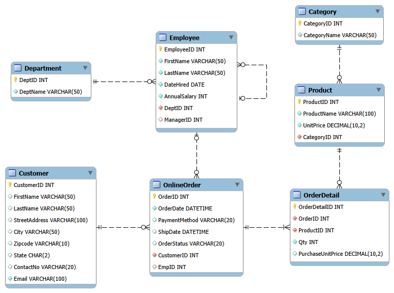

# Grocery Database: MySQL Demonstration

This repository contains SQL scripts designed to support hands-on demonstrations and exercises for an introductory database course using **MySQL** and **MySQL Workbench**.

The scripts use a synthetic grocery database to demonstrate relationships between tables, Cartesian products, `CROSS JOIN`, `INNER JOIN`, `NATURAL JOIN`, `LEFT JOIN`, self-joins, multi-table queries, aggregate functions, grouping, filtering aggregated results, views, and subqueries.

## Files

### 1. `01 Create and Populate Grocery Database.sql`

This script creates and populates the `grocery` database with synthetic data for classroom demonstrations. It provides related tables representing products, product categories, employee departments, customers, employees, orders, and order details.

### 2. `02 Join Operations.sql`

This completed script contains 49 numbered tasks that progressively introduce queries involving multiple tables, beginning with Cartesian products and continuing through joins, aggregate calculations, and views.

The examples use `Category`, `Department`, `Product`, `OrderDetail`, `OnlineOrder`, `Customer`, and `Employee`. Here, `Department` represents employee departments and is used alongside `Category` to illustrate a Cartesian product, not a product-to-department relationship.

Topics covered include:

- **Examining tables:** Using `USE`, `SHOW TABLES`, and `SELECT *` to inspect the database.
- **Cartesian products:** Comparing comma-separated tables with explicit `CROSS JOIN` syntax.
- **Ambiguous column references:** Demonstrating why shared column names must be qualified with table names or aliases.
- **Filtering matching rows:** Using `WHERE` to retain related records from a Cartesian product.
- **Table aliases:** Writing concise, qualified column references.
- **INNER JOIN:** Using `ON` to specify matching conditions between related tables.
- **NATURAL JOIN:** Exploring automatic matching based on identically named columns and its limitations.
- **Filtering joined records:** Finding products belonging to a particular category.
- **Multi-table joins:** Combining three or more related tables to retrieve information across customers, orders, order details, and products.
- **Aggregate functions:** Using `COUNT()`, `AVG()`, and `SUM()` to summarize joined data.
- **Grouping:** Using `GROUP BY` to calculate statistics for each category, order, customer, or department.
- **Calculated columns:** Multiplying order quantities by unit prices to calculate line-item subtotals.
- **Filtering groups:** Using `HAVING` to retrieve orders that meet a minimum grand total.
- **Distinct records:** Using `DISTINCT` and `COUNT(DISTINCT ...)` to eliminate duplicate results and count unique values.
- **Purchase-time pricing:** Adding `PurchaseUnitPrice` to `OrderDetail` and using `UPDATE` with `INNER JOIN` to populate the column.
- **Self-joins:** Joining the `Employee` table to itself to examine reporting relationships, count direct reports, and compare employees with their managers.
- **LEFT JOIN:** Preserving records without matching rows, including departments without employees and customers without orders.
- **Finding unmatched records:** Using `LEFT JOIN` with `IS NULL` to demonstrate the anti-join pattern.
- **Counting unmatched records:** Comparing `COUNT(*)` with `COUNT(column)` when using `LEFT JOIN`.
- **Handling NULL values:** Using `COALESCE()` to display zero spending for customers without purchases.
- **Views:** Creating and querying `ListOfCustomerSpending` to reuse a multi-table aggregate query.
- **Sorting and limiting results:** Using `ORDER BY` and `LIMIT` to identify the highest-spending customer.

#### Key Takeaways

- A Cartesian product pairs every row in one table with every row in another; a join condition can restrict the result to matching pairs.
- Unqualified column names are ambiguous when multiple referenced tables contain the same column name.
- Table aliases make multi-table queries easier to read and maintain.
- `INNER JOIN` returns matching rows based on the condition specified in `ON`.
- `NATURAL JOIN` infers matching columns from shared names, which can make queries sensitive to schema changes.
- `LEFT JOIN` preserves all rows from the left table, even when no matching rows exist in the right table.
- An `INNER JOIN` excludes unmatched rows, while a `LEFT JOIN` can be used to identify them.
- The anti-join pattern uses `LEFT JOIN` with `IS NULL` to identify records without matching rows.
- A self-join allows a table to be joined with itself, such as when retrieving employees and their managers.
- `DISTINCT` eliminates duplicate result rows, which is useful when a record has multiple matching rows in another table.
- `WHERE` filters individual rows, while `HAVING` filters groups after aggregation.
- `COUNT(*)` counts joined rows, while `COUNT(column)` counts only non-NULL values. This distinction is important when using `LEFT JOIN`.
- `SUM(Qty)` counts units purchased, which is different from counting order details or distinct products.
- `GROUP BY` produces one aggregate result per group, such as one summary per category, order, customer, or department.
- A line-item subtotal can be calculated as `Qty * UnitPrice`; an order total can be calculated using `SUM(Qty * UnitPrice)`.
- `PurchaseUnitPrice` records the unit price associated with an order detail, allowing purchase totals to remain independent of subsequent changes to current product prices.
- `COALESCE()` can replace a NULL aggregate result with a specified value, such as zero.
- A view is a named query that can simplify the reuse of complex SQL statements.
- A regular MySQL view does not store a separate copy of its results. Changes to the underlying tables are reflected when the view is queried again, without recreating it.

**Important:** One statement intentionally produces an ambiguous-column error by comparing `CategoryID = CategoryID` after joining tables that both contain a `CategoryID` column. The corrected statement explicitly qualifies each column. Execute the demonstration statements individually and examine the error before proceeding.

Another demonstration intentionally contains a logic error when counting employees using `COUNT(*)` with `LEFT JOIN`. The following task corrects the count using `COUNT(EmployeeID)`. Compare the results to understand why departments without employees may otherwise be counted incorrectly.

### 3. `03 Join Exercises.sql`

This script contains 10 exercises for students to practice writing queries involving multiple related tables. Some exercises include sample solutions, while others are left for students to complete.

The exercises cover:

- **INNER JOIN:** Retrieving employees and their departments, customers who have placed orders, and products that have been purchased.
- **LEFT JOIN:** Including employees without department assignments, departments without employees, and customers without orders.
- **Aggregation with joins:** Counting orders per customer and calculating average employee salaries by department.
- **Finding unmatched records:** Identifying products that have never been purchased.
- **Self-joins:** Retrieving employees and their managers, including employees without managers.
- **Conditional joins:** Identifying customers who have not placed an order during a specified year.

The exercises reinforce the distinction between `INNER JOIN` and `LEFT JOIN`, particularly when related records may be missing.

**Note:** Task 10 uses 2025 instead of the 2026 example demonstrated during the lecture so students can compare the results.

### 4. `04 Subqueries.sql`

**Work in progress:** This script is still being developed and may be expanded or revised as additional topics are introduced.

The current version contains 12 numbered tasks divided into two sections: SQL puzzles and an introduction to subqueries.

#### Section 1: SQL Puzzles

The first three tasks reinforce previously introduced concepts, including joins, grouping, aggregate functions, and filtering groups.

Topics include:

- **Duplicate names:** Identifying customers who share the same first and last names using `GROUP BY` and `HAVING`.
- **Repeated purchases:** Identifying customers with multiple order-detail records for the same product.
- **Purchases across different orders:** Using `COUNT(DISTINCT OrderID)` to identify customers who purchased the same product in multiple orders.

These exercises emphasize the differences between counting records, counting distinct values, and interpreting grouped query results.

#### Section 2: Subqueries

The remaining tasks introduce subqueries through examples involving employee salaries, customers, and orders.

Topics currently covered include:

- **Scalar subqueries:** Comparing employee salaries with the average salary calculated by another query.
- **IN:** Identifying customers and employees whose IDs appear in the results of a subquery.
- **NOT IN:** Identifying records whose IDs do not appear in the results of a subquery.
- **Duplicate values in subqueries:** Demonstrating why `DISTINCT` is unnecessary for membership testing with `IN` and `NOT IN`.
- **NULL and three-valued logic:** Investigating how NULL affects comparisons using `NOT IN`.
- **Nullable foreign keys:** Examining how an optional `EmpID` in `OnlineOrder` affects queries identifying employees who have not processed orders.
- **Handling NULL in subqueries:** Comparing `COALESCE()` with `IS NOT NULL` as approaches to prevent NULL values from affecting `NOT IN`.

#### Key Takeaways

- A subquery is a query nested within another SQL statement.
- A scalar subquery returns a single value that can be used in a comparison.
- Subqueries allow queries to use values calculated from the current database rather than relying on fixed values.
- `IN` tests whether a value matches any value returned by a subquery.
- `NOT IN` tests whether a value differs from every value returned by a subquery.
- Duplicate values in a subquery do not change the results of `IN` or `NOT IN`.
- A NULL value returned by a subquery can cause `NOT IN` to evaluate to UNKNOWN for otherwise unmatched values.
- Conditions in a `WHERE` clause retain only rows for which the condition evaluates to TRUE.
- Filtering NULL values using `IS NOT NULL` can prevent unexpected results when using `NOT IN`.
- `COALESCE()` can replace NULL with a specified value, but the replacement must be chosen carefully to avoid conflicts with valid data.

**Important:** The examples involving `EmpID` intentionally demonstrate the effect of NULL values on `NOT IN`. Because `EmpID` in `OnlineOrder` is optional, the subquery may return NULL and produce unexpected results. The following task demonstrates two approaches to address this issue.

## Getting Started

1. Open MySQL Workbench and connect to your MySQL server.
2. Open and execute `01 Create and Populate Grocery Database.sql` to create and populate the database.
3. Open `02 Join Operations.sql` and execute the numbered tasks in sequence.
4. Examine the intentionally incorrect queries and compare them with their corrected versions.
5. Explore multi-table joins, aggregate calculations, self-joins, and the handling of unmatched records.
6. Create and query the `ListOfCustomerSpending` view, then use `ORDER BY` and `LIMIT` to identify the highest-spending customer.
7. Open `03 Join Exercises.sql` and complete the exercises to practice writing queries involving multiple tables.
8. Open `04 Subqueries.sql` to explore SQL puzzles, scalar subqueries, `IN`, `NOT IN`, and the effects of NULL values.

**Note:** The demonstration assumes that the `grocery` database and its sample records have already been created. Execute the setup script before running the queries.

The join operations script also includes an `ALTER TABLE` statement to add `PurchaseUnitPrice` to `OrderDetail`. **Skip this statement if the column already exists**, as attempting to add it again will produce an error. The subsequent `UPDATE` statement initializes purchase-time prices using the current product prices in the synthetic dataset.

The `CREATE VIEW` statement should also be executed only when the view does not already exist. A view does not need to be recreated when records in the underlying tables change.

## Database Overview

| Table | Description |
|---|---|
| `Category` | Stores product categories used to classify products. |
| `Department` | Stores organizational departments to which grocery store employees belong. |
| `Product` | Stores product information, including category associations and current unit prices. |
| `OrderDetail` | Stores individual order line items, including purchased products, quantities, and purchase-time unit prices. |
| `OnlineOrder` | Stores order-level information and associates orders with customers. |
| `Customer` | Stores customer information associated with orders. |
| `Employee` | Stores employee information, including department assignments, salaries, hiring dates, and reporting relationships. |

### Entity-Relationship Diagram

The following diagram illustrates the structure of the grocery database, including its tables, primary keys, foreign keys, and relationships.

## Requirements

- MySQL 8.0 or later
- MySQL Workbench (recommended)

## Disclaimer

All data provided in this repository is **synthetic and intended for educational purposes only**. The records do not represent actual customers, employees, transactions, or businesses. Any resemblance to real individuals or entities is purely coincidental.
