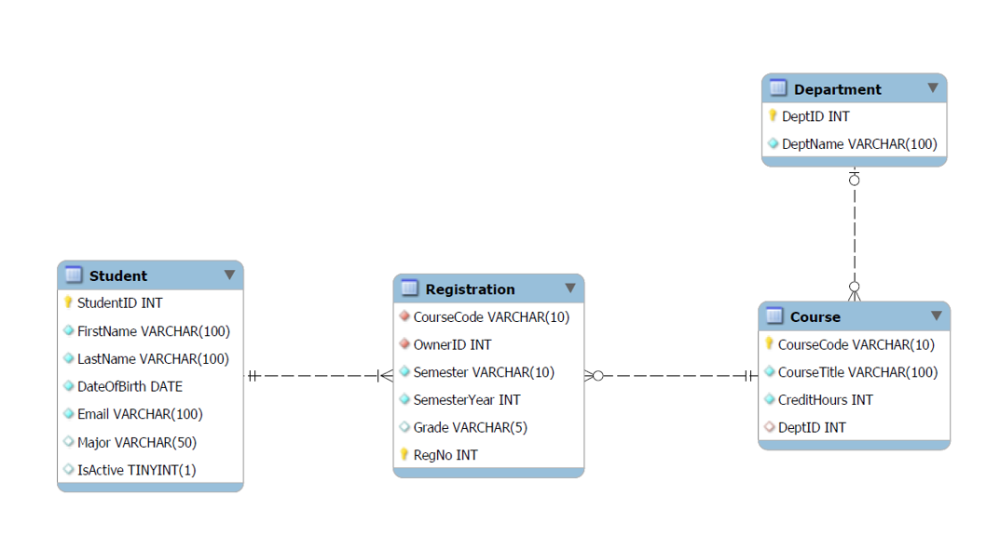

# University Database: MySQL Demonstration

This repository contains SQL scripts designed to support hands-on demonstrations and exercises for an introductory database course using **MySQL** and **MySQL Workbench**.

The scripts use a simplified university database to demonstrate database creation, data manipulation, integrity constraints, referential actions, and SQL queries.

## Files

### 1. `01 Create University Database.sql`

This script guides students through creating and modifying a university database.

Topics covered include:

- Creating databases and tables using `CREATE DATABASE` and `CREATE TABLE`.
- Defining primary keys, foreign keys, and unique constraints.
- Inserting, updating, and deleting records.
- Modifying table structures using `ALTER TABLE`.
- Introducing `AUTO_INCREMENT` and composite keys.
- Enforcing data integrity using `CHECK` constraints.
- Exploring referential actions such as `ON UPDATE CASCADE` and `ON DELETE SET NULL`.
- Reconstructing the database model through reverse engineering in MySQL Workbench.

**Important:** Some SQL statements intentionally produce errors to demonstrate how MySQL enforces integrity constraints. These statements are annotated with explanations and should be executed individually as part of the guided demonstration.

### 2. `02 Sample Database Data.sql`

This script populates the university database with additional synthetic records, providing a larger dataset for practicing SQL queries.

The expanded dataset supports exercises involving:

- Retrieving and filtering records using `SELECT` and `WHERE`.
- Sorting results using `ORDER BY`.
- Working with logical and comparison operators.
- Handling missing values using `IS NULL` and `IS NOT NULL`.

### 3. `03 Basic Select Statements.sql`

This script introduces fundamental SQL querying techniques using the `Student`, `Course`, and `Registration` tables. The examples progressively demonstrate how to retrieve, filter, and sort data, including how logical expressions affect query results.

Topics covered include:

- **Retrieving and projecting data:** Using `SELECT *` to retrieve all columns and specifying individual columns to display.
- **Filtering records:** Using `WHERE` with comparison operators such as `=`, `!=`, and `<`.
- **Combining conditions:** Using `AND`, `OR`, and parentheses to construct logical expressions.
- **Operator precedence:** Demonstrating how `AND` is evaluated before `OR` and how incorrect grouping can produce unintended results.
- **Matching multiple values:** Using `IN` to simplify conditions involving several possible values.
- **Handling missing values:** Using `IS NULL` and `IS NOT NULL` to identify records with missing or available information.
- **Sorting query results:** Using `ORDER BY` with `ASC` and `DESC`, including sorting by multiple columns.
- **Filtering ranges:** Using `BETWEEN` to retrieve records within an inclusive range.
- **Using arithmetic expressions:** Applying the modulo (`%`) operator within a `WHERE` condition.
- **Combining SQL clauses:** Using projection, filtering, and sorting together in a single query.

#### Key Takeaways

- `SELECT` determines which columns appear in the result, while `WHERE` determines which rows are included.
- `AND` has higher precedence than `OR`. Without appropriate parentheses, a query may return unintended results even when its SQL syntax is valid.
- Parentheses can be used to explicitly group conditions and ensure that the intended logic is applied.
- `IN` provides a concise alternative to multiple equality comparisons joined by `OR`.
- `NULL` represents missing or unknown information and must be checked using `IS NULL` or `IS NOT NULL`, rather than ordinary equality comparisons.
- `ORDER BY` controls how results are arranged. Multiple columns can be used to specify additional sorting criteria when values are tied.
- `BETWEEN` includes both endpoints of the specified range.
- Arithmetic expressions can be used in filtering conditions, such as identifying registrations from even-numbered years.
- SQL clauses can be combined to answer more specific questions without modifying the underlying database.

**Important:** The script includes an intentionally incorrect logical condition involving `AND` and `OR`. Although the query executes successfully, it does not produce the intended results because of operator precedence. A corrected version is provided immediately afterward to demonstrate the importance of grouping conditions using parentheses.

### 4. `04 Intermediate Select Statements.sql`

**Status: Work in Progress**

This script continues the SQL querying activities introduced in
`03 Basic Select Statements.sql`, building upon previously discussed
concepts such as filtering, logical operators, sorting, and handling
`NULL` values. The activities progressively introduce additional SQL
features, including pattern matching, scalar functions, calculated
columns, type conversion, duplicate elimination, and date comparisons.

The examples use the `Course`, `Student`, and `Registration` tables to demonstrate how
SQL can retrieve, transform, and evaluate data without modifying the
underlying records. Particular emphasis is placed on scalar functions,
which operate on individual values and can generate a corresponding
result for each row in a query.

Topics currently covered include:

- **Pattern matching:** Using `LIKE` with the `%` wildcard to match zero or more characters.
- **Single-character matching:** Using the `_` wildcard to match exactly one character.
- **Excluding patterns:** Using `NOT LIKE` to retrieve records that do not match specified patterns.
- **Combining conditions:** Using `AND` and `OR` with multiple `NOT LIKE` conditions.
- **Logical errors:** Demonstrating how an incorrect logical operator can produce unintended results even when the SQL statement executes successfully.
- **Scalar functions:** Introducing built-in functions that operate on individual values.
- **String manipulation:** Using `SUBSTRING()` to extract portions of course codes and `CONCAT()` to combine string values.
- **Calculated columns:** Using expressions and aliases to generate additional columns in query results without modifying the underlying tables.
- **Type conversion:** Using `CAST()` to explicitly convert extracted string values into numeric values.
- **Sorting calculated values:** Using `ORDER BY` with calculated column aliases and multiple sorting criteria.
- **Using aliases:** Demonstrating why aliases defined in `SELECT` can be referenced in `ORDER BY` but not in `WHERE` at the same query level.
- **Eliminating duplicates:** Using `DISTINCT` to retrieve unique values and understanding how it applies to the selected columns.
- **Comparing values with NULL:** Examining how ordinary comparisons involving `NULL` evaluate to `UNKNOWN` and affect query results.
- **Handling NULL values:** Using `IFNULL()` and `COALESCE()` to provide alternative values when expressions evaluate to `NULL`.
- **Date comparisons:** Using comparison operators to filter records based on `DATE` values, including inclusive and exclusive date boundaries.
- **String lengths:** Using `CHAR_LENGTH()` to count the characters in student last names.
- **Date ranges and components:** Using `BETWEEN`, `YEAR()`, and `MONTH()` to filter dates and extract year or month values.
- **Current dates and age calculations:** Using `CURDATE()` and `TIMESTAMPDIFF()` to calculate age, including the effect of whether a birthday has passed.
- **Sorting and limiting results:** Using `LIMIT` with `ORDER BY` and examining the effect of missing tie-breaking criteria.
- **Date-related conditions:** Finding birthdays in a given month and identifying leap years using arithmetic and logical conditions.
- **Conditional expressions:** Using simple and searched `CASE` expressions, including optional `ELSE` clauses, to assign grade points and remarks.
- **Aggregate functions:** Using `COUNT(*)` and `COUNT(column)` to count registrations and distinguish all rows from non-`NULL` values.
- **Grouping results:** Using `GROUP BY` to summarize registrations by academic year.

#### Key Takeaways

- `LIKE` and `NOT LIKE` support pattern matching using `%` for zero or more characters and `_` for exactly one character.
- Logical operators must be combined carefully to produce the intended results. A syntactically valid query may still contain logical errors.
- `SUBSTRING()` extracts characters from a string, while `CONCAT()` combines multiple string values into a single result.
- Scalar functions return a single value for each invocation. When applied to column values in a `SELECT` query, they produce a corresponding result for each row without modifying the stored data.
- SQL functions can transform and calculate values directly within queries without modifying the underlying database.
- Calculated columns can be created using expressions and assigned meaningful aliases using `AS`.
- `CAST()` explicitly converts values between compatible data types. Values that appear similar in query results may have different data types.
- Calculated column aliases can be referenced in `ORDER BY` but not in `WHERE` at the same query level.
- `DISTINCT` eliminates duplicate rows based on the complete set of selected columns. It does not necessarily change the results when each selected row is already unique.
- Comparisons involving `NULL` generally evaluate to `UNKNOWN`. The `WHERE` clause includes only rows whose conditions evaluate to `TRUE`.
- `IFNULL()` and `COALESCE()` provide alternative values for `NULL` expressions without modifying stored data.
- Date values can be compared using operators such as `<`, `<=`, and `=`. Inclusive and exclusive date boundaries can sometimes express equivalent filtering conditions.
- `CHAR_LENGTH()` returns the number of characters in a string, while `YEAR()` and `MONTH()` extract components of date values.
- `BETWEEN` includes both endpoints of a range. For a `DATE` column, direct date comparisons do not require wrapping the column in `DATE()`.
- `CURDATE()` returns the current date based on the MySQL session time zone. `TIMESTAMPDIFF(YEAR, ...)` counts complete elapsed years and accounts for whether a birthday has passed.
- `ORDER BY` controls the ordering of rows, but `LIMIT 1` may return any tied row when no additional tie-breaking criterion is provided.
- Simple `CASE` compares an expression with specified values; searched `CASE` evaluates conditions in order. Both forms support an optional `ELSE`, and return `NULL` if no condition matches and `ELSE` is omitted.
- `COUNT(*)` counts all rows, whereas `COUNT(column)` excludes rows in which that column is `NULL`.
- `GROUP BY` produces a separate aggregate result for each group, while `WHERE` filters individual rows before grouping.

**Important:** The script includes intentionally incorrect queries to demonstrate common SQL mistakes:

- An incorrect query uses `OR` instead of `AND` when excluding course titles containing either of two specified words. Although the query executes successfully, it produces unintended results because of the logical operator used.
- Another query attempts to reference a calculated column alias in the `WHERE` clause. This produces an error because the alias defined in `SELECT` is not available to `WHERE` at the same query level.

- Another query attempts to use a calculated birth-year alias in `WHERE`, which is not permitted at the same query level.
- An age estimate based only on subtracting birth years can be inaccurate when the birthday has not yet occurred.

Corrected versions are provided immediately afterward to demonstrate the underlying concepts and encourage comparison and discussion.

Additional examples and topics will be added as the lesson progresses.

## Getting Started

1. Open MySQL Workbench and connect to your MySQL server.
2. Open `01 Create University Database.sql`.
3. Execute the SQL statements incrementally, following the comments and observing the expected errors.
4. Once the demonstration is complete, open `02 Sample Database Data.sql`.
5. Execute the sample data script to populate the database with additional records.
6. Open `03 Basic Select Statements.sql`.
7. Continue with `04 Intermediate Select Statements.sql` to explore pattern matching, scalar and date functions, conditional expressions, and introductory aggregation.
8. Execute the queries individually, observe the results, and review how each query demonstrates a particular SQL concept.

**Note:** Execute the scripts in the order indicated by their filenames. The data and query scripts assume that the university database and its tables have already been created.

## Database Overview

| Table | Description |
|---|---|
| `Student` | Stores student information, including declared majors and enrollment status. |
| `Course` | Stores course information, including course codes, titles, and credit hours. |
| `Registration` | Stores course registrations, semesters, academic years, and grades. |
| `Department` | Stores academic departments associated with courses. |

### Entity-Relationship Diagram

The following diagram illustrates the structure of the university database, including its tables, primary keys, foreign keys, and relationships.

**Note:** The diagram represents the final database structure after the schema modifications demonstrated in `01 Create University Database.sql`.

## Requirements

- MySQL 8.0 or later
- MySQL Workbench (recommended)

## Disclaimer

All data provided in this repository is **synthetic and intended for educational purposes only**. The records do not represent actual individuals or institutional records. Any resemblance to real individuals or entities is purely coincidental.
